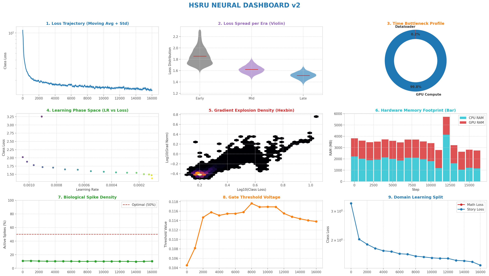

# HSRU-Small: Training Metrics

Training logs and settings for the **HSRU-Small** language model.

## 1. Setup

| | |
|---|---|
| Parameters | 26.6M |
| Architecture | 12 HSRU modules, hidden size 256, logic size 1024 |
| Context during training | 1024 tokens (truncated BPTT chunks of 256) |
| Dataset | TinyStories |
| Tokenizer | GPT-2 BPE (50,257 tokens) |
| Optimiser | Batch size 32, max LR 1.06e-3, cosine decay |
| Hardware | One 12 GB consumer NVIDIA GPU |

PyTorch weights for researchers: [hsameer/hsru-small](https://huggingface.co/hsameer/hsru-small). These are not optimised for inference speed. Use the C++ demo for timing.

## 2. Results

| Metric | Value |
|---|---|
| Best validation loss | 1.23 (perplexity ~3.4) at step 16,000 |
| C++ generation speed | ~120 to 130 tokens/s on an Apple Silicon CPU |
| Inference memory | Fixed-size recurrent state, no KV cache |

Perplexity depends on the tokenizer, so these numbers are only directly comparable with models that use the same GPT-2 tokenizer. Planned comparisons:

* The published TinyStories models (which use the same tokenizer), scored on the full validation set
* Same-size Transformer and Mamba/RWKV baselines trained with identical data, steps and hardware

## 3. Training dashboard

Generated from the raw training log:

Loss decreased steadily and gradient norms stayed stable through training, with no sign of exploding or vanishing gradients.

## 4. Raw logs

The full step-by-step training log (loss, gradient norms, learning rate, timestamps) is in [Metrics/LLM_Log.csv](Metrics/LLM_Log.csv).
